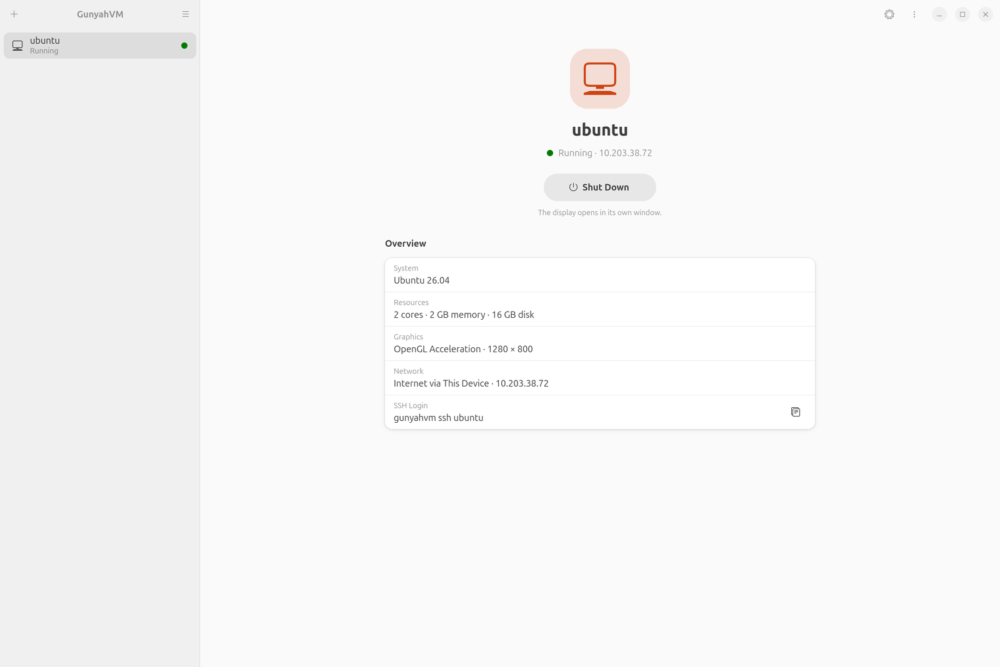

<!-- SPDX-License-Identifier: GPL-2.0-only -->
<!-- Copyright (C) 2026 yzddMr6 -->
# GunyahVM

**Run Windows, Linux and macOS virtual machines natively on Snapdragon tablets. Gunyah hardware virtualization, the desktop shown inside the application, GPU-accelerated graphics; macOS is created in one step from Apple's servers.**

[简体中文](README.md) · [Download](https://github.com/yzddmr6/GunyahVM/releases/latest) · [Issues](https://github.com/yzddmr6/GunyahVM/issues)



## Highlights

- **Three systems at native speed**: Ubuntu/Linux, Windows 11 and macOS all run natively as ARM64 on the tablet's Gunyah hypervisor, not in an emulator.
- **macOS in one step**: click **+ → macOS** and the application downloads only the roughly 13 GB it needs from Apple's servers, assembles it locally, and the first boot reaches the login window. Pause and resume at any time; every VM has its own control key.
- **The desktop inside the application**: the guest desktop is embedded in a GTK window; scale it, go full screen, reopen it at any time. Closing the window leaves the VM running.
- **GPU acceleration**: virgl (OpenGL) for Linux; the Adreno GPU through a Metal plugin for macOS.
- **One package**: the application, VM runtime, Linux guest kernel and Mesa, and the macOS boot kit are all in the single `gunyahvm` package. VMs run as your account; only a fixed small helper is privileged.
- **Everyday management**: the GUI and the command line share one library: snapshots, port forwarding, NAT networking, SSH control, shared folders for Linux, text clipboard for Linux and macOS.

| Guest | Creation | Display and graphics | Integration |
| --- | --- | --- | --- |
| Ubuntu 26.04 / Linux | Downloaded and configured automatically, or an ARM64 raw/qcow2 disk | In-app display, virgl OpenGL | Shared folders, text clipboard, SSH |
| Windows 11 | Installed offline from your own ARM64 ISO | In-app display, 1280×720 software display | SSH control, remote desktop |
| macOS 27.2 | Created in one step from Apple's servers | In-app display, Metal (Adreno), 1280×800 | Text clipboard, SSH control |

| Device | Ubuntu / Linux | Windows 11 | macOS |
| --- | --- | --- | --- |
| [Xiaomi Pad 8 Pro](https://github.com/yzddmr6/xiaomipad-8pro-mainline) (1.3.1 or later) | ✅ | ✅ | ✅ |
| [OnePlus Pad 2 Pro](https://github.com/yzddmr6/onepluspad-2pro-mainline) (v0.9.1 or later) | ✅ | ✅ | 🟡 can hang under heavy graphics load; restart the VM |

## How it works

- **Interface and core**: the GTK/libadwaita application and the command line call one core and share one user library, so configuration, state, shutdown and snapshots behave the same. See [Architecture](docs/architecture.md).
- **VMs and display**: crosvm runs ARM64 guests through the kernel's Gunyah interface, and Casilda brings the guest display into the application window; virglrenderer provides OpenGL for Linux, and macOS has its own VMM and renderer. See [Runtime components](docs/runtime-components.md).
- **macOS creation**: files are fetched member by member from Apple and decrypted locally, and GunyahVM's XNU kernel and board drivers are linked into Apple's kernel collection; a temporary Linux helper VM writes the APFS disk, so the host needs no APFS driver and no administrator password. See [macOS](docs/macos.md).
- **Privilege and data**: a fixed polkit helper only sets up networking and resource limits, then drops back to your user; system disks and keys stay on the device. See [Security model](docs/security.md).

## Download and install

You need one of the devices above running mainline Ubuntu 26.04 (with a Gunyah-capable kernel) and a Wayland desktop. Update the device system to its latest release first.

1. Download `gunyahvm_*_arm64.deb` from the [latest release](https://github.com/yzddmr6/GunyahVM/releases/latest), together with Casilda and the other extra dependencies listed on the release page.
2. In the download directory, run:

   ```sh
   sudo apt install ./gunyahvm_*_arm64.deb
   ```

3. Open GunyahVM as your ordinary desktop user. Main menu → **System Check** shows drivers, permissions, memory and runtime components; **Load Drivers** only loads modules the running kernel already has.

## Create and use

### Ubuntu / Linux

Click **+ → Ubuntu 26.04 LTS → Create**; choose a graphics mode for a desktop. When it is ready, click **Start** and **Open Display**. **Linux Disk Image** imports an installed ARM64 raw/qcow2 system instead (automatic account setup needs cloud-init).

```sh
gunyahvm create ubuntu --guest-payload --gpu virgl --start
gunyahvm ssh ubuntu
gunyahvm stop ubuntu
```

After shutting down, add shared folders in the settings; the guest sees them in `/mnt/gunyahvm/<tag>`. Text clipboard needs `wl-clipboard` in the guest's Wayland desktop. More in the [Linux guide](docs/linux.md).

### Windows 11

Bring a Windows 11 **ARM64** ISO and a license (this project provides no Windows image or activation). Click **+ → Windows 11**, choose the ISO, enter a local account and password, and create. Windows is deployed offline on the first start; open the display to finish the region and privacy settings.

```sh
gunyahvm create windows --os windows11 --iso /path/to/windows-arm64.iso --local-user vmuser
gunyahvm start windows
gunyahvm view windows
```

At least 4608 MiB of memory and a 64 GiB disk (it grows as used). Details in the [Windows guide](docs/windows.md).

### macOS

Click **+ → macOS**, enter a name, a macOS account and password and the disk size, and click **Create**. The application downloads about 13 GB from Apple's servers and then sets it up locally; the progress bar can **Pause** and **Resume** at any time. When it is done, click **Start** and **Open Display** and sign in with that account.

```sh
gunyahvm create-macos macos       # after an interruption, run it again to resume
gunyahvm start macos
gunyahvm view macos
```

Creating needs at most about 27 GB of free space and the finished VM uses about 22 GB; the VM uses 9 GB of memory and 6 processors, its resolution is fixed at 1280×800, and it has no sound or shared folders. GunyahVM ships no Apple software; your device downloads the macOS files directly from Apple, and using macOS is subject to Apple's [software license agreement](https://www.apple.com/legal/sla/). More in [macOS](docs/macos.md).

## Upgrade

Shut down all VMs, download the new `gunyahvm_*_arm64.deb` and run the same `sudo apt install ./gunyahvm_*_arm64.deb`. Do not uninstall first, and do not delete or recreate VMs. When upgrading from the four packages of 1.2 and earlier, apt replaces `gunyahvm-runtime`, `gunyahvm-guest-kernel` and `gunyahvm-guest-mesa` with the new single package.

VMs live in `~/.local/share/gunyahvm/vms/`; upgrades leave their disks, configuration and keys untouched. Back up a VM with its configuration and keys after shutting it down. Update notices only link to the download; nothing is installed automatically.

## FAQ

- **Nothing starts?** Open **System Check** or run `gunyahvm check`. Make sure the device kernel supports Gunyah, you are in a Wayland session and there is enough memory; do not run it as root.
- **The window got bigger but the guest resolution did not?** Fitting the window scales; Windows and macOS have fixed resolutions.
- **The VM is still running after closing the application?** That is expected. Open the application again to get back to its display; click **Shut Down** to stop it. A forced stop is like pulling the power.
- **How many VMs can run at once?** One per user at a time; no other VM can run while macOS is being created.
- **The macOS download was interrupted?** Open the application again and click **Resume** on that VM, or run `gunyahvm create-macos NAME` again; downloaded parts are not fetched again.
- **Can macOS use an Apple ID, iCloud or the App Store?** No, those services need Apple hardware identity.
- **Sound, USB passthrough?** Not supported yet; neither are live migration, guest Secure Boot or vTPM.
- **How do I report a problem?** Open an [issue](https://github.com/yzddmr6/GunyahVM/issues) with the device, system and application versions, the error and the steps to reproduce; remove personal data from logs and never upload Apple files or keys. For security issues see [Security](SECURITY.md).

A writable shared folder can be changed or deleted by the guest; VNC, when explicitly enabled on the command line, is reachable by other local accounts; NAT is not isolation from the internet.

## Development and acknowledgements

[Building](docs/building.md) · [Contributing](CONTRIBUTING.md) · [New devices](docs/new-device.md). Thanks to iceland-vms/iceland-gvm, Droid-VM (DroidVM, macOS-DroidVM, UniXNU), crosvm, minijail, Casilda, virglrenderer, Linux, Mesa/Turnip, linux-apfs and apfsprogs, blacktop/ipsw, GTK/libadwaita, librevm, edk2 and virtio-win. Exact sources are in [NOTICE](NOTICE).

GunyahVM is licensed under [GPL-2.0-only](LICENSE); third-party components keep their own [licenses](debian/copyright).
