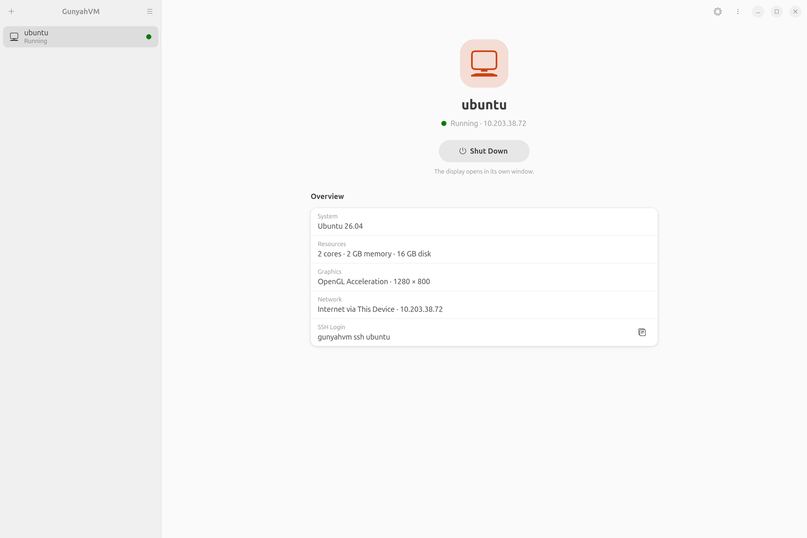

<!-- SPDX-License-Identifier: GPL-2.0-only -->
<!-- Copyright (C) 2026 yzddMr6 -->
# GunyahVM

**Run ARM64 Linux and Windows virtual machines on Snapdragon 8 Elite tablets running mainline Ubuntu, from a desktop app or the command line.**

[简体中文](README.zh-CN.md)



## Features

- **Create and manage:** create a VM from Ubuntu 26.04, downloaded and set up automatically, or from a local ARM64 raw/qcow2 disk. Default resources suit the device and can be changed later. The CLI uses the same VM configuration.
- **Touch-friendly interface:** a GNOME app in English or Simplified Chinese, following the system language. Each VM page shows its state, the next action and an overview; settings are saved as you change them.
- **Display and 3D:** open the guest desktop in a window, with software display or OpenGL acceleration through virgl. Available modes depend on the host kernel and installed runtime components.
- **Lifecycle:** start, shut down and restart VMs. Closing the manager leaves the VM running; reopen it to continue managing the guest.
- **Network and sharing:** NAT networking, SSH access, local TCP/UDP port forwarding and writable shared folders through 9p.
- **Windows guests:** install offline from your own Windows 11 ARM64 ISO, create a local account, control the guest through key-authenticated SSH and shut it down cleanly. The [Windows guide](docs/windows.md) explains deployment and display options. Windows guests run on Xiaomi Pad 8 Pro with system release 1.1.1 or later.
- **Updates:** optional release notifications at application startup, with a link to download the new version. Checks contact GitHub without sending device information; disable them in Preferences.

GunyahVM runs crosvm on the host kernel's Qualcomm Gunyah interface. The VM and its renderer run under your ordinary user account.

## Devices and requirements

GunyahVM needs a host kernel with Gunyah VM support. This system release provides it:

| Device | Required system release |
| --- | --- |
| Xiaomi Pad 8 Pro | [Xiaomi Pad 8 Pro mainline Ubuntu](https://github.com/yzddmr6/xiaomipad-8pro-mainline/releases/latest) **1.1.1 or later** |

Installing GunyahVM does not add Gunyah support to a kernel without it. The packages use GTK4/libadwaita, systemd/logind, udev, polkit and NetworkManager; local guest windows need a Wayland desktop session.

## Quick start

1. Download all four `gunyahvm*_arm64.deb` packages from the same [release](https://github.com/yzddmr6/GunyahVM/releases/latest) into one directory.
2. Open a terminal in that directory and install them together:

   ```sh
   sudo apt install ./gunyahvm*_arm64.deb
   ```

3. Open **GunyahVM** from the application list. If it reports that the device can't run virtual machines yet, open **System Check** from the main menu and click **Load Drivers** to load the installed host VM modules. This does not install or update the kernel.
4. Click **+**, choose **Ubuntu 26.04 LTS** or **Linux Disk Image**, review the name and resources, and click **Create**. When the VM is ready, click **Start**.

Use your normal desktop account. The [Linux guide](docs/linux.md) covers image requirements, graphics, SSH, sharing and CLI commands.

## Limitations

- Each user can run **one VM at a time**.
- Windows requires your own ARM64 ISO and applicable licence. It uses software display and local VNC; guest 3D acceleration and shared folders are not provided.
- Windows installation needs no Internet connection. The default shared NAT is not Internet isolation; restrict external access through host network policy while retaining the local network used for SSH control.
- Audio, USB passthrough and live migration are not available.
- Guest Secure Boot and vTPM are not provided; VM configurations from other tools or older formats are not imported.

## Use and troubleshooting

Stop a VM before changing its resources or shared folders. Before updating the application, shut down all VMs. **Force Off** acts like cutting power and can lose guest data.

If you turn on **Allow VNC Connections** in a VM's display settings, VNC listens only on loopback (`127.0.0.1`), but has no authentication: **other accounts on the same host can view and control the guest**. Leave it disabled on a host with untrusted local users. Shared folders are writable by the guest within your host account's permissions; share only files you intend to expose. See the [security model](docs/security.md) for access boundaries.

If creation or startup fails, open **System Check** from the main menu or run `gunyahvm check --json` to identify missing drivers, permissions or runtime components. Report reproducible problems in [Issues](https://github.com/yzddmr6/GunyahVM/issues), including the device, system and application versions, error message and steps to reproduce. Remove personal paths and guest data from logs. Report vulnerabilities through [Security reporting](SECURITY.md).

## Development

Start with [Building](docs/building.md) for package assembly and checks, and [Contributing](CONTRIBUTING.md) for submitting changes. The [architecture guide](docs/architecture.md) explains the core, device discovery and VM lifecycle. To extend integration, use [Adding a device profile](docs/new-device.md) or the [runtime component interface](docs/runtime-components.md).

## Acknowledgements

- **iceland-vms** (mzakamin-hub): GTK interface, configuration models, graphics integration, guest control and port forwarding.
- **iceland-gvm** (mzakamin-hub): Gunyah command-line design and crosvm adaptations.
- **DroidVM**: framebuffer, VNC and boot-shim designs, plus guest firmware and driver components.
- **crosvm and minijail**: virtual machine monitor and device sandboxing.
- **virglrenderer, Linux and Mesa**: graphics virtualization, guest kernel and graphics drivers.
- **GTK and libadwaita**: desktop interface toolkit and widgets.
- **librevm**: ideas for download mirrors, console replay and balloon safeguards.
- **edk2 and virtio-win**: UEFI firmware and guest driver sources kept in the component inputs.

Exact sources and retained attribution are recorded in [NOTICE](NOTICE).

## License

GunyahVM is licensed under [GPL-2.0-only](LICENSE). Third-party components keep their original licenses, listed in [debian/copyright](debian/copyright). Each release includes the complete corresponding source.
