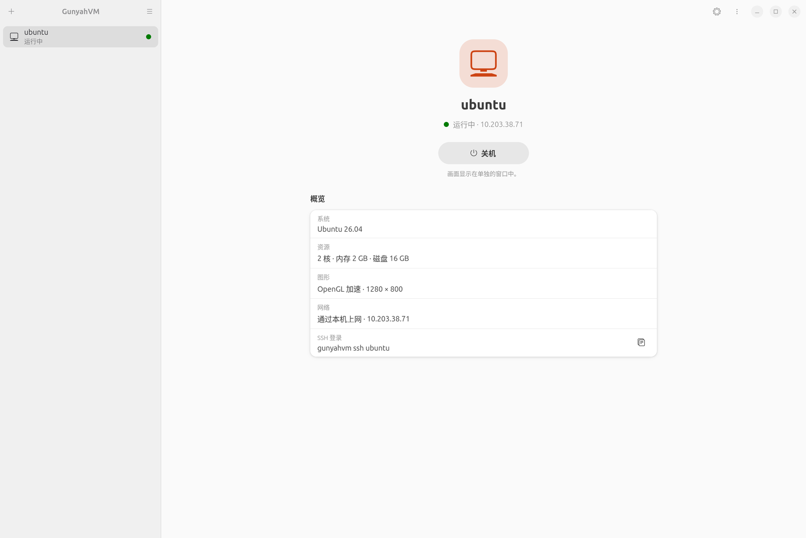

<!-- SPDX-License-Identifier: GPL-2.0-only -->
<!-- Copyright (C) 2026 yzddMr6 -->
# GunyahVM

**在骁龙平板上原生运行 Windows、Linux 和 macOS 虚拟机。Gunyah 硬件虚拟化，桌面直接显示在应用里，图形有 GPU 加速；macOS 一键从 Apple 的服务器创建。**

[English](README.en.md) · [下载](https://github.com/yzddmr6/GunyahVM/releases/latest) · [问题反馈](https://github.com/yzddmr6/GunyahVM/issues)



## 亮点

- **三种系统，原生速度**：Ubuntu/Linux、Windows 11 和 macOS 都以 ARM64 原生运行在平板的 Gunyah 虚拟机监控器上，不是模拟器。
- **macOS 一键创建**：点 **+ → macOS**，应用只从 Apple 的服务器下载需要的约 13 GB，在本机装好，第一次启动就是登录界面。可暂停、续传，每台虚拟机有自己的控制密钥。
- **桌面就在应用里**：来宾桌面嵌在 GTK 窗口中，可缩放、全屏、随时重新打开；关掉窗口，虚拟机继续运行。
- **GPU 加速**：Linux 的 native 模式用 Turnip（Vulkan），并可用 `gunyahvm-graphics-run --native` 让程序走 freedreno OpenGL（都经 DRM 原生上下文）；桌面合成和 virgl 模式的 OpenGL 走 virgl；macOS 经 Metal 插件用 Adreno GPU。
- **一个安装包**：应用、虚拟机运行时、Linux 来宾内核和 Mesa、macOS 启动套件都在 `gunyahvm` 一个包里。虚拟机以你的账户运行，特权部分只有固定的小助手。
- **日常管理**：图形界面和命令行共用一个库：快照、端口转发、NAT 网络、SSH 控制，Linux 共享文件夹，Linux 与 macOS 的文本剪贴板。

| 来宾 | 创建 | 显示与图形 | 集成 |
| --- | --- | --- | --- |
| Ubuntu 26.04 / Linux | 自动下载并配置，或导入 ARM64 raw/qcow2 磁盘 | 应用内显示，Turnip Vulkan，freedreno 或 virgl OpenGL | 共享文件夹、文本剪贴板、SSH |
| Windows 11 | 用你自己的 ARM64 ISO 离线安装 | 应用内显示，1280×720 软件显示 | SSH 控制、远程桌面 |
| macOS 27.2 | 从 Apple 的服务器一键创建 | 应用内显示，Metal（Adreno），1280×800 | 文本剪贴板、SSH 控制 |

| 设备 | Ubuntu / Linux | Windows 11 | macOS |
| --- | --- | --- | --- |
| [小米平板 8 Pro](https://github.com/yzddmr6/xiaomipad-8pro-mainline)（1.3.1 起） | ✅ | ✅ | ✅ |
| [一加平板 2 Pro](https://github.com/yzddmr6/onepluspad-2pro-mainline)（v0.9.1 起） | ✅ | ✅ | 🟡 较重的图形负载下可能卡住，需重启虚拟机 |

## 怎么工作

- **界面与核心**：GTK/libadwaita 应用和命令行调用同一个核心，读写同一个用户库，配置、状态、关机和快照行为一致。见[架构](docs/architecture.zh-CN.md)。
- **虚拟机与显示**：crosvm 经内核的 Gunyah 接口运行 ARM64 来宾，Casilda 把来宾显示接进应用窗口；virglrenderer 提供 Linux 的 virgl OpenGL 和 DRM 原生上下文（Turnip、freedreno），macOS 有自己的 VMM 与渲染器。见[运行组件](docs/runtime-components.zh-CN.md)。
- **macOS 创建**：按成员从 Apple 下载、本机解密，把 GunyahVM 的 XNU 内核与板级驱动链接进 Apple 的内核集合；一台临时 Linux 助手虚拟机写入 APFS 磁盘，宿主不需要 APFS 驱动，也不用输入管理员密码。见 [macOS](docs/macos.zh-CN.md)。
- **权限与数据**：固定的 polkit 助手只负责网络和资源上限，然后降回普通用户；系统盘和密钥只在本机。见[安全模型](docs/security.zh-CN.md)。

## 下载与安装

需要运行主线 Ubuntu 26.04 的上述设备（内核支持 Gunyah）和 Wayland 桌面。推荐先把设备系统更新到最新版。

1. 从[最新发布](https://github.com/yzddmr6/GunyahVM/releases/latest)下载 `gunyahvm_*_arm64.deb`。上述设备的系统已自带它需要的 Casilda 运行库，不用另装别的包。
2. 在下载目录执行：

   ```sh
   sudo apt install ./gunyahvm_*_arm64.deb
   ```

3. 用普通桌面账户打开 GunyahVM。启动或新建虚拟机时自动加载当前内核已有的虚拟机驱动，不用先手动加载。主菜单 → **系统检查**查看驱动、权限、内存和运行组件。

## 创建和使用

### Ubuntu / Linux

点击 **+ → Ubuntu 26.04 LTS → 创建**；要桌面就选图形模式。完成后点**启动**、**打开显示**。也可以选**Linux 磁盘镜像**导入已装好的 ARM64 raw/qcow2 系统（自动配置账户需要 cloud-init）。

```sh
gunyahvm create ubuntu --start
gunyahvm ssh ubuntu
gunyahvm stop ubuntu
```

停机后可在设置里添加共享文件夹，来宾在 `/mnt/gunyahvm/<标签>` 访问。文本剪贴板需要来宾 Wayland 桌面装好 `wl-clipboard`。更多见 [Linux 指南](docs/linux.zh-CN.md)。

### Windows 11

准备 Windows 11 **ARM64** ISO 和许可证（本项目不提供 Windows 镜像或激活）。点击 **+ → Windows 11**，选 ISO、填写本地账户和密码，点创建。启动后自动离线部署；打开显示完成地区和隐私设置。

```sh
gunyahvm create windows --os windows11 --iso /path/to/windows-arm64.iso --local-user vmuser
gunyahvm start windows
gunyahvm view windows
```

至少 4608 MiB 内存、64 GiB 磁盘（按需增长）。详见 [Windows 指南](docs/windows.zh-CN.md)。

### macOS

点击 **+ → macOS**，填写名称、macOS 账户和密码、磁盘大小，点**创建**。应用从 Apple 的服务器下载约 13 GB，再在本机装好，进度条随时可以**暂停**和**继续**。完成后点**启动**、**打开显示**，用刚才的账户登录。

```sh
gunyahvm create-macos macos       # 中断后重跑同一条命令即可续传
gunyahvm start macos
gunyahvm view macos
```

创建过程中最多需要约 27 GB 可用空间，完成后约占 22 GB；虚拟机使用 9 GB 内存和 6 个处理器，分辨率固定为 1280×800，没有声音和共享文件夹。GunyahVM 不附带 Apple 软件，macOS 的文件由你的设备直接从 Apple 下载；使用 macOS 需遵守 Apple 的[软件许可协议](https://www.apple.com/legal/sla/)。更多见 [macOS](docs/macos.zh-CN.md)。

## 升级

正常关闭所有虚拟机，下载新版 `gunyahvm_*_arm64.deb`，同样执行 `sudo apt install ./gunyahvm_*_arm64.deb`。不用先卸载，也不要删除或重建虚拟机。从 1.2 及更早的四个包升级时，apt 会用新的单个包替换 `gunyahvm-runtime`、`gunyahvm-guest-kernel`、`gunyahvm-guest-mesa`。

虚拟机都在 `~/.local/share/gunyahvm/vms/`，升级不会改动它们的磁盘、配置和密钥。备份时先关机，连同配置和密钥一起备份。版本通知只提供下载入口，不会自动安装。

## 常见问题

- **无法启动？** 打开**系统检查**，或执行 `gunyahvm check`。确认设备内核支持 Gunyah、处在 Wayland 会话、内存足够；不要用 root 运行。
- **窗口变大了，来宾分辨率没变？** 窗口适配是缩放，Windows 和 macOS 的分辨率是固定的。
- **关掉应用后虚拟机还在？** 这是正常的。重新打开应用就能回到它的显示；要停止就点**关机**。强制停止相当于断电。
- **能同时运行几台？** 内存够就能同时开多台，各自有独立的网络、显示和关机。开机时内存不够，会提示还剩多少、哪些虚拟机正在占用；创建 macOS 时也能照常运行别的虚拟机。
- **macOS 提示无法映射启动内存？** macOS 启动时要一大块连续内存，GunyahVM 启动前会先整理平板内存。仍出现这个提示时，关掉其他虚拟机和占内存的应用再启动；还不行就重启平板，先开 macOS。
- **macOS 下载中断了？** 重新打开应用，在这台虚拟机上点**继续**，或重跑 `gunyahvm create-macos 名称`；已下载的部分不会重下。
- **macOS 能用 Apple ID、iCloud 或 App Store 吗？** 不能，这些服务需要 Apple 硬件身份。
- **没有声音、USB 直通？** 目前都不支持；也不支持热迁移、来宾 Secure Boot 和 vTPM。
- **怎样报告问题？** 在 [Issues](https://github.com/yzddmr6/GunyahVM/issues) 写明设备、系统和应用版本、错误信息和复现步骤；删去日志里的个人信息，不要上传 Apple 的文件或密钥。安全问题见[安全报告](SECURITY.zh-CN.md)。

可写共享文件夹可被来宾修改或删除；命令行显式开启的 VNC 可被本机其他账户访问；NAT 不等于与外网隔离。

## 开发与致谢

[构建](docs/building.zh-CN.md) · [贡献](CONTRIBUTING.zh-CN.md) · [新增设备](docs/new-device.zh-CN.md)。感谢 iceland-vms/iceland-gvm、Droid-VM（DroidVM、macOS-DroidVM、UniXNU）、crosvm、minijail、Casilda、virglrenderer、Linux、Mesa/Turnip、linux-apfs 与 apfsprogs、blacktop/ipsw、GTK/libadwaita、librevm、edk2 和 virtio-win。准确来源见 [NOTICE](NOTICE)。

GunyahVM 采用 [GPL-2.0-only](LICENSE) 许可，第三方组件保留各自的[许可证](debian/copyright)。
