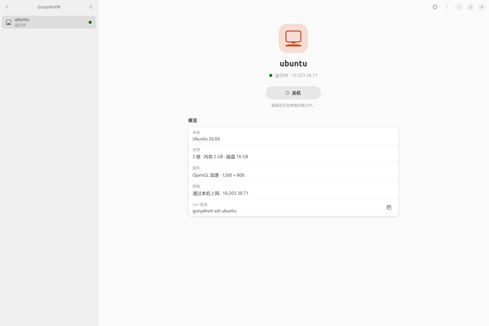

<!-- SPDX-License-Identifier: GPL-2.0-only -->
<!-- Copyright (C) 2026 yzddMr6 -->
# GunyahVM

**在运行主线 Ubuntu 的骁龙 8 至尊版平板上运行 ARM64 Linux 和 Windows 虚拟机，可用桌面应用或命令行管理。**

[English](README.md)



## 功能

- **创建和管理**：用 Ubuntu 26.04（自动下载并完成设置）或本地 ARM64 raw/qcow2 磁盘创建虚拟机。资源默认值按设备给出，之后可以修改。命令行共用同一份虚拟机配置。
- **适合触控的界面**：GNOME 应用，跟随系统语言显示简体中文或英文。每台虚拟机一页，显示状态、下一步操作和配置概览；设置改动即时保存。
- **显示与 3D**：在窗口中打开来宾桌面，支持软件显示和通过 virgl 提供的 OpenGL 加速。可选模式取决于宿主内核和已安装的运行组件。
- **生命周期**：启动、关机和重启虚拟机。关闭管理器后虚拟机继续运行，重新打开即可继续管理。
- **网络与共享**：NAT 网络、SSH 连接、本机 TCP/UDP 端口转发，以及virtiofs 只读或可写共享文件夹（兼容已有的 9p 共享）。
- **Windows 来宾**：使用自己的 Windows 11 ARM64 ISO 离线安装，创建本地账户，通过密钥 SSH 控制来宾并正常关机。[Windows 使用指南](docs/windows.zh-CN.md)说明部署与显示方式。Windows 来宾可在系统 1.1.1 及以上的小米平板 8 Pro 上运行。
- **更新**：应用启动时可检查新版本，提供下载入口。检查会访问 GitHub，不发送设备信息；可在**首选项**中关闭。

GunyahVM 通过宿主内核的 Qualcomm Gunyah 接口运行 crosvm。虚拟机及其渲染器以普通用户身份运行。

## 设备与要求

GunyahVM 需要宿主内核支持 Gunyah 虚拟机。以下系统版本提供这项支持：

| 设备 | 所需系统版本 |
| --- | --- |
| 小米平板 8 Pro | [小米平板 8 Pro 主线 Ubuntu](https://github.com/yzddmr6/xiaomipad-8pro-mainline/releases/latest) **1.1.1 及以上** |

宿主内核不支持时，仅安装 GunyahVM 无法补上。软件包使用 GTK4/libadwaita、systemd/logind、udev、polkit 和 NetworkManager；在本机打开来宾窗口需要 Wayland 桌面会话。

## 快速开始

1. 从同一次 [Release](https://github.com/yzddmr6/GunyahVM/releases/latest) 下载全部四个 `gunyahvm*_arm64.deb` 软件包，放到同一目录。
2. 在该目录打开终端，一起安装：

   ```sh
   sudo apt install ./gunyahvm*_arm64.deb
   ```

3. 从应用列表打开 **GunyahVM**。如果提示这台设备暂时无法运行虚拟机，从主菜单打开**系统检查**，点击**加载驱动**，加载宿主已安装的虚拟机模块；这不会安装或更新内核。
4. 点击 **+**，选择 **Ubuntu 26.04 LTS** 或 **Linux 磁盘镜像**，确认名称和资源后点击**创建**。创建完成后点击**启动**。

请使用普通桌面账户。[Linux 使用指南](docs/linux.zh-CN.md)说明镜像要求、图形、SSH、共享和命令行用法。

## 限制

- 每个用户同时只能运行**一台虚拟机**。
- Windows 需要自备 ARM64 ISO 和适用的许可证；使用应用内软件显示，不提供来宾 3D 加速或共享文件夹。
- Windows 安装无需互联网；默认共享 NAT 并非外网隔离。要限制来宾访问互联网，须在宿主设置网络策略，同时保留用于 SSH 控制的本机网络。
- 不支持声音、USB 直通和热迁移。
- 不提供来宾 Secure Boot 和 vTPM；不导入其他工具或旧格式的虚拟机配置。

## 使用与排障

修改资源或共享文件夹前先关闭虚拟机。更新应用前关闭全部虚拟机。**强制关闭**相当于断电，可能丢失来宾数据。

应用内显示使用账户私有的 Wayland 套接字。命令行显式开启的旧式 VNC 允许其他本机账户连接。可写共享文件夹中的文件可被来宾修改或删除。[安全模型](docs/security.zh-CN.md)

创建或启动失败时，从主菜单打开**系统检查**或运行 `gunyahvm check --json`，查看缺失的驱动、权限或运行组件。可复现的问题请提交到 [Issues](https://github.com/yzddmr6/GunyahVM/issues)，附上设备、系统与应用版本、错误信息和复现步骤。日志中请去掉个人路径和来宾数据。安全漏洞请通过[安全问题报告](SECURITY.zh-CN.md)反馈。

## 开发

[构建指南](docs/building.zh-CN.md)介绍软件包组装与检查，[贡献指南](CONTRIBUTING.zh-CN.md)说明如何提交改动。[架构指南](docs/architecture.zh-CN.md)解释核心、设备探测和虚拟机生命周期。扩展集成时，请参阅[新增设备档案](docs/new-device.zh-CN.md)或[运行组件接口](docs/runtime-components.zh-CN.md)。

## 致谢

- **iceland-vms**（mzakamin-hub）：GTK 界面、配置模型、图形集成、来宾控制和端口转发。
- **iceland-gvm**（mzakamin-hub）：Gunyah 命令行设计和 crosvm 适配。
- **DroidVM**：帧缓冲、VNC 和启动垫片设计，以及来宾固件和驱动组件。
- **crosvm 和 minijail**：虚拟机监控器和设备沙箱。
- **virglrenderer、Linux 和 Mesa**：图形虚拟化、来宾内核和图形驱动。
- **GTK 和 libadwaita**：桌面界面工具包和控件。
- **librevm**：下载镜像源、控制台回放和 balloon 防护思路。
- **edk2 和 virtio-win**：组件输入中保留的 UEFI 固件和来宾驱动源码。

精确来源和原作者声明见 [NOTICE](NOTICE)。

## 许可

GunyahVM 采用 [GPL-2.0-only](LICENSE)。第三方组件保留各自的许可证，清单见 [debian/copyright](debian/copyright)。每个版本都附带完整的对应源码。
