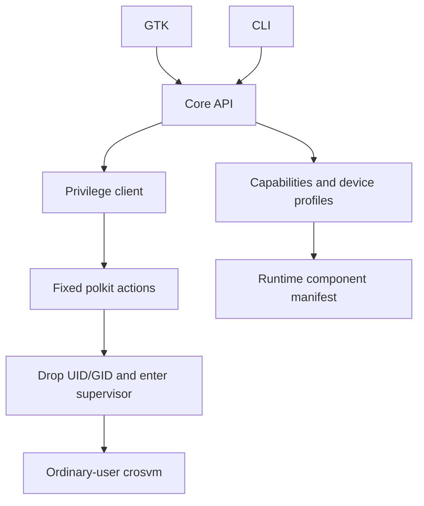

<!-- SPDX-License-Identifier: GPL-2.0-only -->
<!-- Copyright (C) 2026 yzddMr6 -->
# Architecture

## Layers

| Layer | Implementation |
| --- | --- |
| Device facts | `host.py`, `capabilities.py`, `components.py`, `devices.py`; profiles in `data/devices/` |
| Core | `core.py`, `config.py`, `storage.py`, `crosvmargs.py`, `lifecycle.py`, `console.py`, `catalogue.py`, `image.py` |
| Guest integration | `seed.py`, `guest-control.py`, `guest-setup.py` |
| Privilege boundary | `privilege.py` → one `gunyahvm-helper` → `privileged.py` |
| Distribution | `debian/`, `packaging/`, package builder |
| Frontends | `cli.py`, `ui/`; both use the core API |

The core imports no GTK. The crosvm adapter returns arguments and environment; a future backend can implement that boundary without changing frontends. No alternative VMM is shipped.

## Discovery and resources

Firmware discovery reads live DT and falls back to the kernel-owned FDT, preserving VMIDs, capability IDs and RM IRQ cells. The kernel/RM remains authoritative for guest allocation. Capability probes inspect the device, extension ioctl, DRM access, CPU topology, memory, shmem THP, sensors and the [runtime manifest](runtime-components.md). No board identity switches a feature on.

DT profiles contain ceilings, conservative guard thresholds, sensor names/types and display defaults. Unknown boards use conservative defaults. Starting checks available memory in addition to total-memory ceilings. Current protected-share absence disables dependent features while preserving plain virgl when its remaining dependencies are available.

## Lifetime and storage

Schema-2 configuration is validated on load and save. No old-format importer or implicit migration exists. Atomic JSON writes use a unique temporary file, fsync and rename. Ordinary-user supervision is independent of the frontend and separated from the VMM's process group. Boot ID plus kernel process start ticks prevent PID reuse from becoming a running VM. A per-user flock permits one active VM.

States distinguish created, starting, running, stopping, restarting, stopped, failed and interrupted. Requested clean shutdown needs a successful guest request and VMM exit; a force stop or timeout does not become a clean result. Guest reset preserves the same owner's lock and network. The supervisor holds a logind delay inhibitor until VMM teardown and network cleanup, with bounded forced termination if clean shutdown cannot finish before sleep.

## Runtime and packaging

The default package set includes locked crosvm/virglrenderer, guest kernel/Mesa through the manifest contract, including their provenance. The application neither scans build-output directories nor changes host kernel or renderer packages to infer support. Packaging supplies systemd/logind, polkit, udev, desktop and AppStream files; VM policy lives in Python modules.
