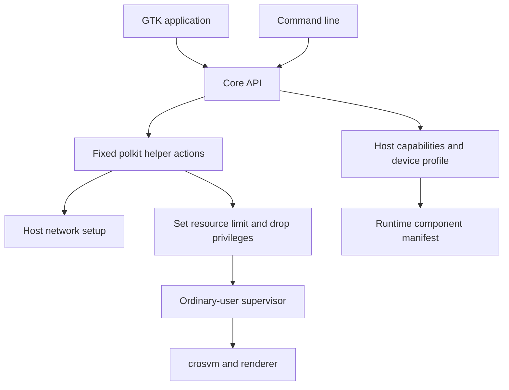

<!-- SPDX-License-Identifier: GPL-2.0-only -->
<!-- Copyright (C) 2026 yzddMr6 -->
# Architecture

This guide explains how the GUI and CLI share VM management, how hardware support is detected, and which processes own a running VM.

## From frontends to crosvm

`ui/` and `cli.py` call the same API in `core.py`. The core imports no GTK. Configuration validation, image preparation and VM lifecycle therefore follow the same path in both frontends. `crosvmargs.py` translates validated configuration and detected capabilities into crosvm arguments and environment variables.

`privilege.py` calls the installed `gunyahvm-helper`; `privileged.py` implements its fixed operations. Privileged setup handles module loading, networking and the launch resource limit. It drops privileges before the supervisor reads user VM configuration or starts crosvm. Guest setup and control use `seed.py`, `guest-setup.py` and `guest-control.py`.

## Device discovery and resource limits

`host.py` reads Gunyah resource-manager information from the live device tree, falling back to the kernel-exported FDT. VMIDs, capability IDs and interrupt cells come from firmware; the kernel and resource manager allocate guests. `capabilities.py` checks device access, extension ioctls, DRM render nodes, CPU topology, memory and sensors. Graphics also require matching entries in the [runtime manifest](runtime-components.md).

`devices.py` matches device-tree compatible strings to profiles in `data/devices/`:

| Device | Compatible | Guest memory ceiling | vCPU ceiling |
| --- | --- | --- | --- |
| Xiaomi Pad 8 Pro | `xiaomi,piano` | 5120 MiB | 4 |
| OnePlus Pad 2 Pro | `oneplus,erhai` | 5120 MiB | 4 |

Profiles contain resource ceilings, battery guard policies, battery selectors and display defaults. They cannot enable hardware features. Unknown boards use conservative defaults and report `UNKNOWN` for the profile.

The memory budget reserves the larger of 1 GiB or 25% of total host RAM. Locked memory is capped at 6 GiB and the guest budget accounts for DMA overhead. Startup also checks current available memory. These are application limits, not physical hardware specifications or a global quota across users.

## VM ownership and lifetime

The ordinary-user supervisor outlives the manager window and runs in a separate process group from crosvm. A per-user file lock permits one active VM. The boot ID and process start ticks identify a process, preventing a reused PID from being mistaken for the VM.

States distinguish `created`, `starting`, `running`, `stopping`, `restarting`, `stopped`, `failed` and `interrupted`. A clean shutdown requires a successful request to the guest and exit of the VMM. A timeout or force stop is recorded as a failure. Guest-requested reset keeps the owner's VM lock and network while the supervisor restarts crosvm.

The supervisor holds a logind delay inhibitor during host sleep preparation. It requests guest shutdown, waits for teardown and cleans up networking. If the guest cannot finish within the deadline, the supervisor forces termination; it does not suspend and resume the guest in place.

## Storage and distribution integration

VM data defaults to `~/.local/share/gunyahvm/`; runtime sockets and locks live under `/run/user/UID/gunyahvm/`. `config.py` validates schema-2 configuration on load and save. `storage.py` writes JSON through a unique temporary file, fsync and rename. No old-format importer or implicit migration is provided.

The Debian packaging supplies desktop integration, polkit, udev, AppArmor and logind configuration. Runtime packages supply crosvm, the renderer and guest payloads at declared paths. The application does not search build directories for binaries. Host kernel support remains the responsibility of the device's system distribution.

Thermal protection reads every zone with a passive trip from the running kernel's sysfs. Startup is refused when any monitored zone reaches its passive temperature, with a throttling message. During operation, reaching that zone's hot temperature requests a clean shutdown; when hot is absent, the threshold is critical minus 5°C. Forced termination occurs only after the existing shutdown deadline. Messages and state records identify the zone, reading and trip; battery protection is unchanged.
