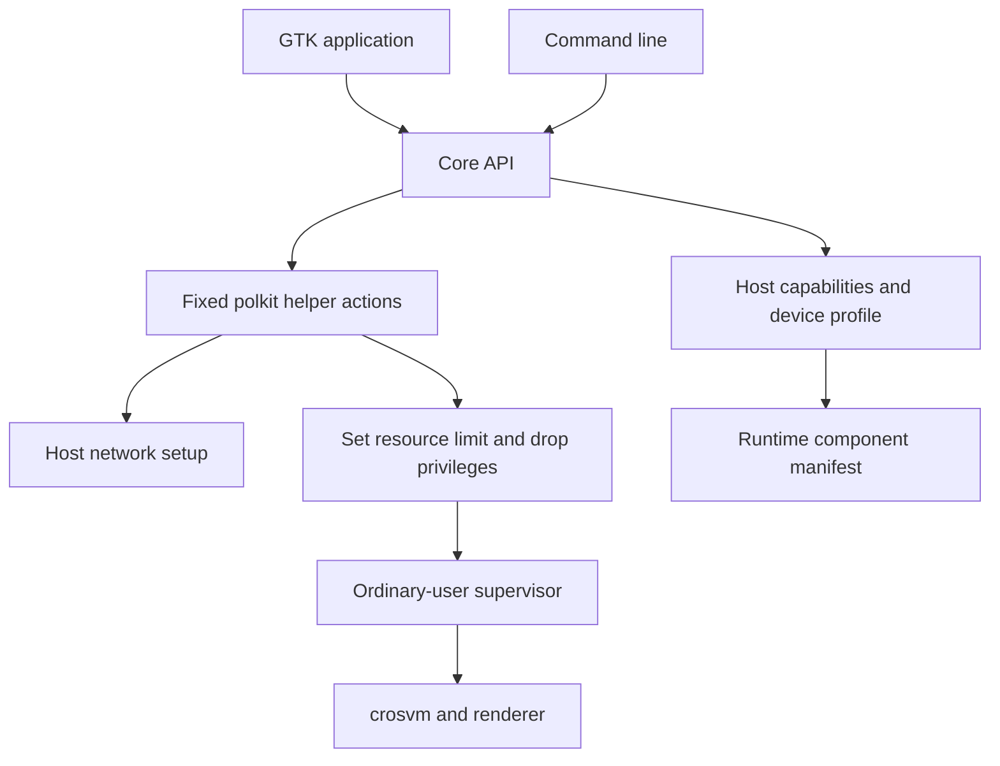

<!-- SPDX-License-Identifier: GPL-2.0-only -->
<!-- Copyright (C) 2026 yzddMr6 -->
# Architecture

This guide explains how the GUI and CLI share VM management, how hardware support is detected, and which processes own a running VM.

## From frontends to crosvm

`ui/` and `cli.py` call the same API in `core.py`. The core imports no GTK. Configuration validation, image preparation and VM lifecycle therefore follow the same path in both frontends. `crosvmargs.py` translates validated configuration and detected capabilities into crosvm arguments and environment variables.

`privilege.py` calls the installed `gunyahvm-helper`; `privileged.py` implements its fixed operations. Privileged setup handles module loading, networking and the launch resource limit. It drops privileges before the supervisor reads user VM configuration or starts crosvm. Guest setup and control use `seed.py`, `guest-setup.py` and `guest-control.py`.

## Device discovery and resource limits

`host.py` reads Gunyah resource-manager information from the live device tree, falling back to the kernel-exported FDT. VMIDs, capability IDs and interrupt cells come from firmware; the kernel and resource manager allocate guests. `capabilities.py` checks device access, extension ioctls, DRM render nodes, CPU topology, memory and sensors. Graphics also require matching entries in the [runtime manifest](runtime-components.md).

`devices.py` matches device-tree compatible strings to profiles in `data/devices/`:

| Device | Compatible | Battery sensors | Default window |
| --- | --- | --- | --- |
| Xiaomi Pad 8 Pro | `xiaomi,piano` | discovered at runtime | 1280×800 |
| OnePlus Pad 2 Pro | `oneplus,erhai` | `qcom-battmgr-bat` | 1280×800 |

Profiles select battery sensors and default window geometry. CPU and memory limits come from the running host.

The guest memory budget uses the kernel’s current MemAvailable estimate. The DMA pool occupies part of guest RAM. The launcher sets memlock from physical RAM and checks available memory at startup. Gunyah pins a guest page when the guest first touches it and keeps it until the VM stops, so startup also subtracts the guest RAM that running VMMs have not touched yet. A short per-user lock admits one starting VM at a time.

## VM ownership and lifetime

The ordinary-user supervisor outlives the manager window and runs in a separate process group from crosvm. Each VM has its own supervisor, VMM, TAP, display socket, port forwards and sleep inhibitor, so several VMs can run at once; NAT VMs that run together need different subnets: new VMs get one no other VM in the library uses, and a Linux or macOS VM whose subnet a running VM already uses moves to a free one when it starts. Windows keeps the subnet its firewall rules were set up for. The boot ID and process start ticks identify a process, preventing a reused PID from being mistaken for the VM.

States distinguish `created`, `starting`, `running`, `stopping`, `restarting`, `stopped`, `failed` and `interrupted`. A clean shutdown requires a successful request to the guest and exit of the VMM. A timeout or force stop is recorded as a failure. Guest-requested reset keeps the VM's network while the supervisor restarts crosvm.

The supervisor holds a logind delay inhibitor during host sleep preparation. It requests guest shutdown, waits for teardown and cleans up networking. If the guest cannot finish within the deadline, the supervisor forces termination; it does not suspend and resume the guest in place.

## macOS creation

`macos_create.py` splits creation into resumable steps and records each in `.creating/<name>/state.json`: member downloads (`macos_inputs.py`, HTTP ranges, CRC-32 and pinned SHA-256) → AEA decryption (`macos_aea.py`, the key unwrapped with HPKE, every segment authenticated, written straight into the new disk's data window) → kernel collection linking (`macos_vendor/kc_build.py`: Apple's kexts stay in place, the kit's XNU and board kexts join them, and the result is compared byte for byte with the pinned hash) → APFS volumes (`apfs_add_volumes.py` with the kit's mkapfs) → two helper-VM boots that write the files → device tree and EFI boot disk → an atomic publish into `vms/`.

The helper VM is the packaged Linux guest kernel with the kit's initrd overlay (apfs.ko, GNU tar, an init script); disks are identified by virtio serial and the job script travels on a FAT exchange disk. It starts through the fixed polkit action `assemble`: root only sets the locked-memory limit and drops back to the caller, whose own process then validates the work directory, starts crosvm and waits for the guest to power off. The host kernel never mounts APFS.

## Storage and distribution integration

VM data defaults to `~/.local/share/gunyahvm/`; runtime sockets and locks live under `/run/user/UID/gunyahvm/`. `config.py` validates schema-2 configuration on load and save. `storage.py` writes JSON through a unique temporary file, fsync and rename. No old-format importer or implicit migration is provided.

The Debian packaging supplies desktop integration, polkit, udev, AppArmor and logind configuration. Runtime packages supply crosvm, the renderer and guest payloads at declared paths. The application does not search build directories for binaries. Host kernel support remains the responsibility of the device's system distribution.

Battery level and passive throttling allow normal VM operation. When a monitored zone reaches its kernel hot trip (critical if hot is absent), the application declines startup or requests a clean guest shutdown.
