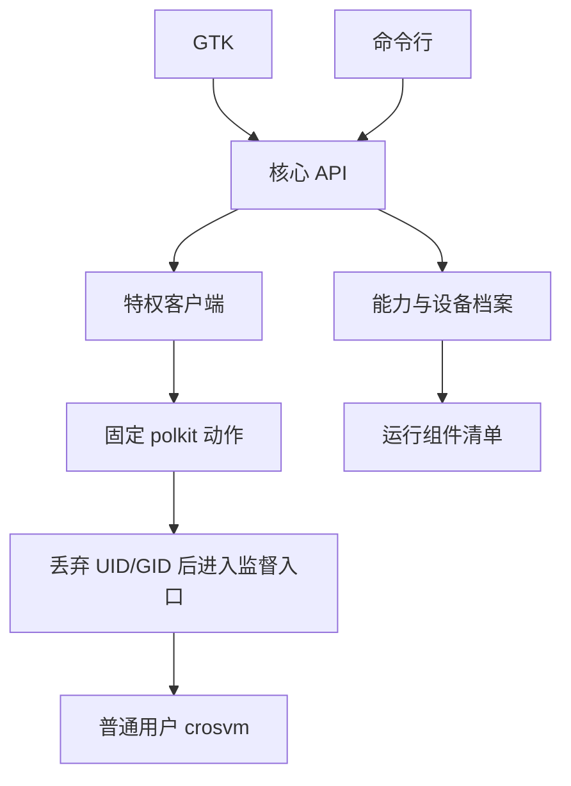

<!-- SPDX-License-Identifier: GPL-2.0-only -->
<!-- Copyright (C) 2026 yzddMr6 -->
# 架构

## 分层

| 层 | 实现 |
| --- | --- |
| 设备事实 | `host.py`、`capabilities.py`、`components.py`、`devices.py`；档案在 `data/devices/` |
| 核心 | `core.py`、`config.py`、`storage.py`、`crosvmargs.py`、`lifecycle.py`、`console.py`、`catalogue.py`、`image.py` |
| 来宾集成 | `seed.py`、`guest-control.py`、`guest-setup.py`、`windows_vm.py`、`windows_agent.py`、`windows/` |
| 权限边界 | `privilege.py` → 唯一 `gunyahvm-helper` → `privileged.py` |
| 发行版 | `debian/`、`packaging/`、打包工具 |
| 前端 | `cli.py`、`ui/`，共用核心 API |

核心不导入 GTK。crosvm 适配器输出参数和环境变量，未来后端可实现同一边界而不修改前端；当前只提供这一种 VMM。

## 探测与资源

固件探测先读 live DT，再回退到内核导出的 FDT，保留 VMID、capability ID 和 RM IRQ cells。来宾分配以内核/RM 为准。能力层探测设备、扩展 ioctl、DRM 权限、CPU 拓扑、内存、shmem THP、传感器及[运行组件清单](runtime-components.zh-CN.md)，不按设备身份开启功能。

DT 档案只保存上限、保守守护阈值、传感器名称/类型和显示默认值。未知设备使用保守默认值；启动时除了总内存上限，还检查当前可用内存。缺少 protected share 时关闭依赖它的功能，保留其余条件齐备的普通 virgl。

## 生命周期与存储

schema 2 配置在读取和保存时校验，不导入旧格式、不隐式迁移。原子 JSON 写入使用独立临时文件、fsync 和 rename。普通用户监督进程不依赖前端，与 VMM 的进程组隔离。boot ID 加内核进程启动 ticks 防止把重用 PID 当成运行中的 VM。每用户 flock 保证同时只有一个活动 VM。

状态区分 created、starting、running、stopping、restarting、stopped、failed、interrupted。请求干净关机须成功发给来宾并等到 VMM 退出；强停或超时不算干净结果。Windows 安装交接还须验证部署 token，来宾 reset 期间保留同一用户的锁和网络。监督进程持有 logind delay inhibitor，直到 VMM 回收及网络清理；睡眠前无法及时干净关机时有界强停。

## 运行组件与打包

默认 deb 带锁定的 crosvm 和 Windows 输入。可选图形/来宾载荷经清单契约连同来源声明接入。应用不扫描构建目录，不通过替换宿主内核或 renderer 包来猜测支持程度。打包层提供 systemd/logind、polkit、udev、桌面和 AppStream 文件；VM 策略保存在 Python 模块中。
