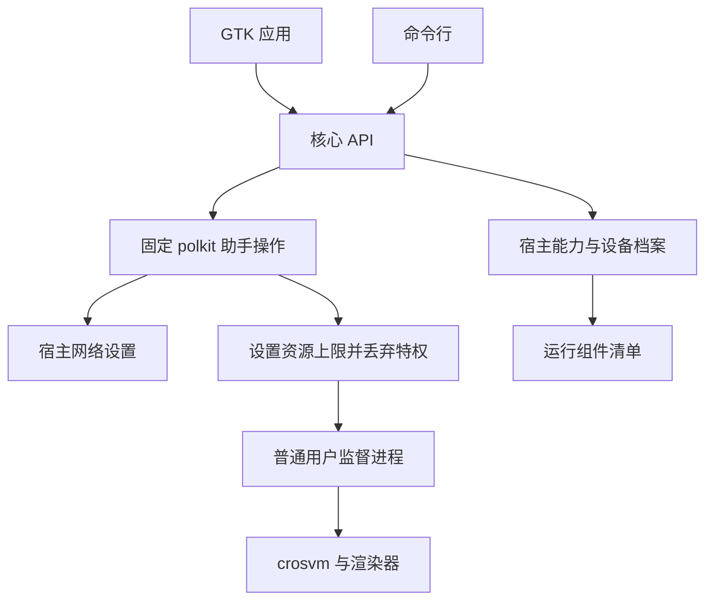

<!-- SPDX-License-Identifier: GPL-2.0-only -->
<!-- Copyright (C) 2026 yzddMr6 -->
# 架构

本文说明图形界面与命令行如何共用虚拟机管理、如何探测硬件支持，以及运行中的虚拟机由哪些进程管理。

## 从前端到 crosvm

`ui/` 和 `cli.py` 调用 `core.py` 中的同一套 API。核心不导入 GTK，因此两个前端使用相同的配置校验、镜像准备和生命周期管理。`crosvmargs.py` 将已校验的配置与探测到的能力转换成 crosvm 参数和环境变量。

`privilege.py` 调用已安装的 `gunyahvm-helper`，由 `privileged.py` 实现固定操作。特权设置负责加载模块、设置网络和启动资源上限。在监督进程读取用户虚拟机配置或启动 crosvm 之前，启动器先丢弃特权。来宾设置与控制使用 `seed.py`、`guest-setup.py` 和 `guest-control.py`。

## 设备探测与资源上限

`host.py` 从运行中的设备树读取 Gunyah 资源管理器信息，失败时回退到内核导出的 FDT。VMID、capability ID 和中断单元来自固件，来宾由内核与资源管理器分配。`capabilities.py` 检查设备权限、扩展 ioctl、DRM 渲染节点、CPU 拓扑、内存和传感器。图形功能还需要[运行组件清单](runtime-components.zh-CN.md)中的对应条目。

`devices.py` 按设备树 compatible 字符串匹配 `data/devices/` 中的档案：

| 设备 | Compatible | 电池传感器 | 默认窗口 |
| --- | --- | --- | --- |
| 小米平板 8 Pro | `xiaomi,piano` | 运行时发现 | 1280×800 |
| 一加平板 2 Pro | `oneplus,erhai` | `qcom-battmgr-bat` | 1280×800 |

设备档案选择电池传感器和默认窗口尺寸。CPU 和内存取自运行中的宿主。

来宾可选内存取自宿主当前的 MemAvailable。DMA 池位于来宾内存之内。启动器按物理 RAM 设置 memlock，开机前复核实际余量。Gunyah 在来宾第一次用到某页时才锁定它，并一直保留到虚拟机停止，所以开机时还要减去正在运行的虚拟机尚未用到的来宾内存。每用户一把短时的锁，保证同一时刻只放行一台正在启动的虚拟机。

## 虚拟机归属与生命周期

普通用户监督进程不随管理器窗口关闭而退出，且与 crosvm 使用不同的进程组。每台虚拟机有自己的监督进程、虚拟机监控器、TAP、显示套接字、端口转发和睡眠抑制锁，所以可以同时运行多台；同时运行的 NAT 虚拟机需要不同的子网：新建的虚拟机会选一个库里别的虚拟机没用的子网；Linux 或 macOS 虚拟机开机时，如果它的子网已被正在运行的虚拟机占用，就换到一个空闲子网。Windows 保持防火墙规则设定时用的子网。进程通过 boot ID 和启动 ticks 标识，避免把重用的 PID 当成虚拟机。

状态区分 `created`、`starting`、`running`、`stopping`、`restarting`、`stopped`、`failed` 和 `interrupted`。正常关机要求成功向来宾发送请求并等待虚拟机监控器退出。超时或强制停止记录为失败。来宾请求重启时，监督进程重启 crosvm，期间保留这台虚拟机的网络。

宿主准备睡眠时，监督进程持有 logind 延迟抑制锁，请求来宾关机，等待进程回收并清理网络。如果来宾无法在时限内退出，就强制终止；这不是保存来宾状态后原地恢复。

## macOS 创建

`macos_create.py` 把创建拆成可续做的步骤，每步完成后记入 `.creating/<名称>/state.json`：按成员下载（`macos_inputs.py`，HTTP Range、CRC-32 与固定 SHA-256）→ 解密 AEA（`macos_aea.py`，HPKE 解出密钥，逐段校验，直接写进新磁盘的数据窗口）→ 链接内核集合（`macos_vendor/kc_build.py`，Apple 的 kext 留在原位，套件里的 XNU 与板级 kext 加入，结果与锁定哈希逐字节比对）→ 建 APFS 卷（`apfs_add_volumes.py` 与套件的 mkapfs）→ 两次助手虚拟机写入文件 → 设备树与 EFI 启动盘 → 原子发布到 `vms/`。

助手虚拟机是打包的 Linux 来宾内核加套件里的 initrd 叠加层（apfs.ko、GNU tar、init 脚本），磁盘按 virtio serial 识别，任务脚本放在一块 FAT 交换盘上。它经固定 polkit 操作 `assemble` 启动：root 只设置锁定内存上限并降回调用者，之后由调用者自己的进程校验工作目录、启动 crosvm 并等待来宾关机。宿主内核从不挂载 APFS。

## 存储与发行版集成

虚拟机数据默认位于 `~/.local/share/gunyahvm/`，运行时套接字和锁位于 `/run/user/UID/gunyahvm/`。`config.py` 在读取和保存时校验 schema 2 配置。`storage.py` 通过独立临时文件、fsync 和 rename 写入 JSON。不提供旧格式导入或隐式迁移。

Debian 打包提供桌面集成、polkit、udev、AppArmor 和 logind 配置。运行组件包按声明的路径提供 crosvm、渲染器和来宾组件。应用不会在构建目录中搜索二进制文件。宿主内核支持由设备的系统发行版提供。

电量和被动降频不影响启动或运行。受监测热区达到内核公布的 hot 温控点（没有 hot 时取 critical）时，应用拒绝启动或请求来宾正常关机。
