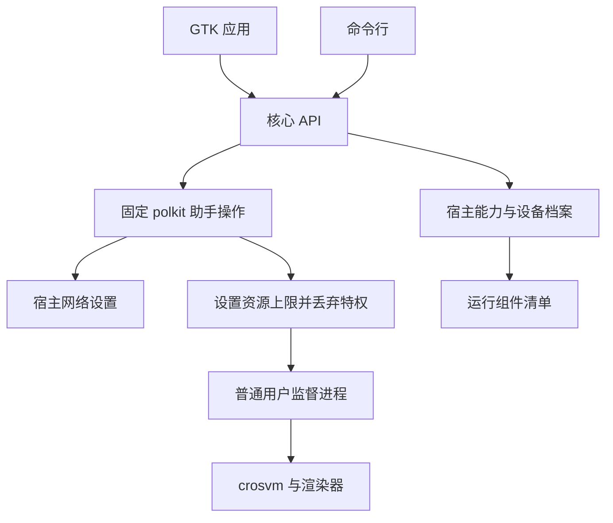

<!-- SPDX-License-Identifier: GPL-2.0-only -->
<!-- Copyright (C) 2026 yzddMr6 -->
# 架构

本文说明图形界面与命令行如何共用虚拟机管理、如何探测硬件支持，以及运行中的虚拟机由哪些进程管理。

## 从前端到 crosvm

`ui/` 和 `cli.py` 调用 `core.py` 中的同一套 API。核心不导入 GTK，因此两个前端使用相同的配置校验、镜像准备和生命周期管理。`crosvmargs.py` 将已校验的配置与探测到的能力转换成 crosvm 参数和环境变量。

`privilege.py` 调用已安装的 `gunyahvm-helper`，由 `privileged.py` 实现固定操作。特权设置负责加载模块、设置网络和启动资源上限。在监督进程读取用户虚拟机配置或启动 crosvm 之前，启动器先丢弃特权。来宾设置与控制使用 `seed.py`、`guest-setup.py` 和 `guest-control.py`。

## 设备探测与资源上限

`host.py` 从运行中的设备树读取 Gunyah 资源管理器信息，失败时回退到内核导出的 FDT。VMID、capability ID 和中断单元来自固件，来宾由内核与资源管理器分配。`capabilities.py` 检查设备权限、扩展 ioctl、DRM 渲染节点、CPU 拓扑、内存和传感器。图形功能还需要[运行组件清单](runtime-components.zh-CN.md)中的对应条目。

`devices.py` 按设备树 compatible 字符串匹配 `data/devices/` 中的档案：

| 设备 | Compatible | 来宾内存上限 | vCPU 上限 |
| --- | --- | --- | --- |
| 小米平板 8 Pro | `xiaomi,piano` | 5120 MiB | 4 |
| 一加平板 2 Pro | `oneplus,erhai` | 5120 MiB | 4 |

档案保存资源上限、电量与温度保护策略、传感器选择条件和显示默认值，不能开启硬件功能。未知设备使用保守默认值，档案状态显示为 `UNKNOWN`。

内存预算为宿主保留 1 GiB 与总内存 25% 中较大的一项。锁定内存上限为 6 GiB，来宾预算还计入 DMA 开销。启动时另查当前可用内存。这些是应用限制，不是物理硬件规格，也不是跨用户的全局配额。

## 虚拟机归属与生命周期

普通用户监督进程不随管理器窗口关闭而退出，且与 crosvm 使用不同的进程组。每用户文件锁保证同时只有一台活动虚拟机。进程通过 boot ID 和启动 ticks 标识，避免把重用的 PID 当成虚拟机。

状态区分 `created`、`starting`、`running`、`stopping`、`restarting`、`stopped`、`failed` 和 `interrupted`。正常关机要求成功向来宾发送请求并等待虚拟机监控器退出。超时或强制停止记录为失败。来宾请求重启时，监督进程重启 crosvm，期间保留所属用户的虚拟机锁和网络。

宿主准备睡眠时，监督进程持有 logind 延迟抑制锁，请求来宾关机，等待进程回收并清理网络。如果来宾无法在时限内退出，就强制终止；这不是保存来宾状态后原地恢复。

## 存储与发行版集成

虚拟机数据默认位于 `~/.local/share/gunyahvm/`，运行时套接字和锁位于 `/run/user/UID/gunyahvm/`。`config.py` 在读取和保存时校验 schema 2 配置。`storage.py` 通过独立临时文件、fsync 和 rename 写入 JSON。不提供旧格式导入或隐式迁移。

Debian 打包提供桌面集成、polkit、udev、AppArmor 和 logind 配置。运行组件包按声明的路径提供 crosvm、渲染器和来宾组件。应用不会在构建目录中搜索二进制文件。宿主内核支持由设备的系统发行版提供。
